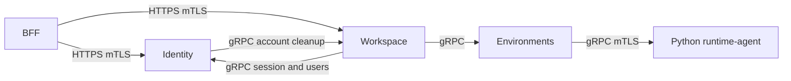

# Сервисы Cellestial

BFF обращается к Identity и Workspace по HTTPS. Оба прикладных входа
требуют сертификат BFF и один действующий заголовок `X-BFF-Key`.
Workspace проверяет пользовательский Bearer через Identity по gRPC.
Workspace вызывает Environments для создания и удаления окружения и
управления сессией. Environments вызывает назначенный Python runtime-agent
по gRPC. Адрес агента определяется по данным Environments.

| Процесс | Ответственность | Данные и секреты |
| --- | --- | --- |
| Identity | Регистрация, вход, 2FA, отзыв сессий, профили и удаление аккаунта | `identity.users`, операции удаления, Redis auth, ключи JWT и TOTP, S3 аватаров |
| Workspace | Блокноты, ячейки, ACL, комментарии, очередь и проекция результатов | Схема `workspace`, ключ подписания курсоров |
| Environments | Provisioning и удаление VPS, warm pool, leases, доступ к агенту | Схема `environments`, Selectel, SSH, runtime PKI |
| Runtime-agent | Kernel, журнал исполнения и файловые операции | SQLite journal, каталог рабочей сессии, сертификат конкретной VPS |

Блокнот, очередь и запись результатов остаются в одной транзакционной
границе Workspace. Ссылки на авторов и адресатов ACL хранят ID Identity.
Логины запрашиваются пакетами до 100 пользователей. SQL выполняется в
схеме владельца, без обращения к чужим таблицам из приложения.

`request_id` переходит из `X-Request-ID` в gRPC metadata. Создание сессии,
приём команды, provisioning и удаление аккаунта сохраняют корреляцию
для фоновой работы. Поля `request_id` в телах start и batch остаются
ключами идемпотентности этих операций.

## Локальный запуск и контракты

`make build-services` собирает `bin/identity`, `bin/workspace`,
`bin/environments`, `bin/migrate` и `bin/identity-admin`.
Перед запуском примените миграции отдельной ролью владельца. Каждому
Go-процессу задаётся `DATABASE_URL` только с правами на его схему.
При запуске выполняется проверка версии схемы и прав роли.

| Настройка | Процессы и значение |
| --- | --- |
| `HTTP_ADDR` | Identity и Workspace, по умолчанию `:8080` |
| `GRPC_ADDR` | Все сервисы, Go по умолчанию `:9090`, агент `0.0.0.0:9090` |
| `ADMIN_ADDR` | Отдельный HTTP listener, Go по умолчанию `:9091`, агент `0.0.0.0:9091` |
| `TLS_CERT_FILE`, `TLS_KEY_FILE`, `TLS_CA_FILE` | Удостоверение текущего процесса и доверенный CA; Go-сервисы с исходящим gRPC используют также ClientAuth EKU |
| `BFF_API_KEY` | Identity и Workspace |
| `IDENTITY_GRPC_ADDR`, `ENVIRONMENTS_GRPC_ADDR` | Workspace, внутренние адреса зависимостей |
| `WORKSPACE_GRPC_ADDR` | Identity, по умолчанию `workspace:9090` |
| `WORKSPACE_CURSOR_KEY` | Workspace, минимум 32 байта, отдельный ключ курсоров |
| `WORKERS_PAUSED` | Все Go-сервисы, `false` по умолчанию. Значение `true` отключает фоновые доменные workers для проверки после переноса |
| `JWT_SECRET`, `TOTP_ENCRYPTION_KEY`, `REDIS_*`, `S3_AVATARS_*` | Identity |
| `RUNTIME_*`, `AGENT_GRPC_PORT` | Environments; агентский порт по умолчанию `9090` |
| `STATE_DIR`, `WORKSPACE_PATH`, `KERNEL_NETWORK`, `KERNEL_DNS`, `PYTHON_IMAGE` | Runtime-agent |

DNS SAN сервисов имеют вид `identity.internal.cellestial.ru`,
`workspace.internal.cellestial.ru`, `environments.internal.cellestial.ru`,
`bff.internal.cellestial.ru` и `probe.internal.cellestial.ru`. Python-агент
использует имя `agent.<UUID VPS>.internal.cellestial.ru`. Идентичность
прогретой VPS остаётся идентичностью её записи в пуле после назначения.

Новый вход агента запускается через `cellestial-runtime-agent-grpc` или
`python -m runtime_agent.rpc.main`. Для установки через Ansible артефакт
должен включать `cellestial-agent-grpc.service`. Установка service unit,
раскладка TLS-файлов, настройка сети и переключение production относятся
к [infra#163](https://github.com/Cringe-Driven-Development-Team/infra/issues/163).

На admin listener каждого процесса доступны `/livez` и `/readyz`. Go-сервисы
отдают там же `/metrics`, а runtime-agent публикует метрики на отдельном
HTTPS-входе с собственным CA. Проверка готовности Workspace включает оба
gRPC сервиса. Сбой индивидуального VPS не снимает готовность Environments
целиком. Параметры подключения описаны в [контракте мониторинга](monitoring.md).
При запуске на одном хосте назначьте процессам разные адреса listeners
и укажите их в переменных адресов зависимостей. Тестовый стенд сам
назначает свободные локальные порты и выпускает тестовые сертификаты.

Контракты для BFF находятся в [Identity](../spec/identity/openapi.json) и
[Workspace](../spec/workspace/openapi.json). Раздельные версии Protobuf
находятся в [proto/cellestial](../proto/cellestial/). Команды
`make contract-generate-services contract-check-services` обновляют и
проверяют HTTP API. `make proto-generate proto-check` используют версии,
зафиксированные в `tools/proto/versions.lock`. Для Python-генерации задайте
`PROTO_PYTHON` с зависимостями из `tools/proto/requirements.txt`.

`make services-test` запускает четыре процесса через mTLS на одноразовых
PostgreSQL и Redis. Тестовый режим использует имитацию облака и kernel,
при этом gRPC вход, SQLite journal и состояние Go обрабатывает рабочий
код. Для полного скачивания 3 ГиБ передайте
`MICROSERVICES_LARGE_FILES=1`, для загрузки 3 ГиБ чанками по 1 МиБ
с повтором первого чанка передайте `MICROSERVICES_LARGE_UPLOAD=1`.
Для импорта и экспорта 128 МиБ передайте `MICROSERVICES_LARGE_NOTEBOOK=1`.
Для прогона через реальный Docker/Jupyter
используйте `RUN_DOCKER_TESTS=1 pytest -m docker` из окружения агента с
образом из текущего исходника. `TEST_KERNEL_IMAGE` задаёт отдельный тег.

HTTP-вход Workspace возвращает безопасные коды ошибок зависимостей.
Внутренний сбой даёт `500 internal`, недоступность — `503`, истёкший
deadline — `504`. Исходный текст RPC в ответ не попадает. Чтение
готовности файлового окружения может повториться после `Unavailable`
с исходным `request_id`. Файловые записи автоматически не повторяются.

Текущий production Dockerfile собирает `cmd/main`, а его startup применяет
старые миграции в `public`. Репозитории этой версии уже используют отдельные
схемы, поэтому автоматическую сборку и выкладку этой ветки через прежний
release producer нужно заблокировать до переключения в infra#163.
До переключения используется выпущенный образ монолита. Локальный запуск
нового кода выполняется через три отдельные команды выше.

## Удаление аккаунта

`identity-admin delete <user_id> <operation_uuid>` принимает долговечное
намерение. Повтор используйте с тем же operation UUID. `identity-admin
status <operation_uuid>` возвращает этап. Нужен отдельный сертификат
`identity-admin.internal.cellestial.ru`, адрес `IDENTITY_GRPC_ADDR` и
обычный набор переменных TLS. Identity отзывает сессии, Workspace закрывает
новые записи и дожидается очистки VPS. После удаления ссылок в Workspace
Identity удаляет аватар и профиль.
